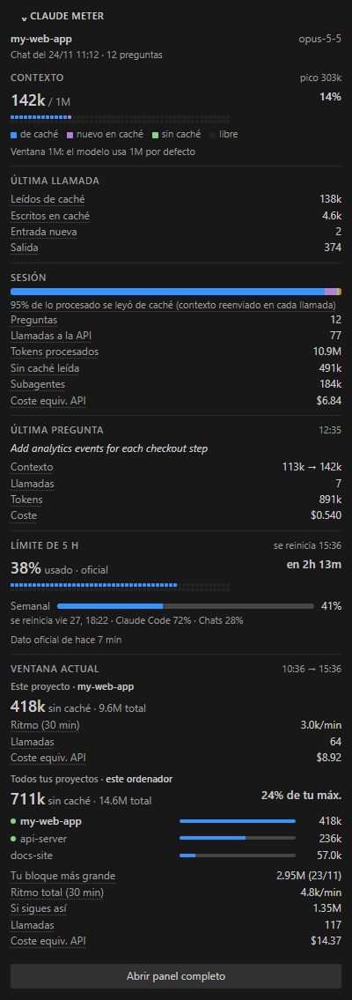
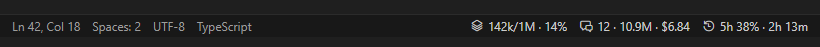
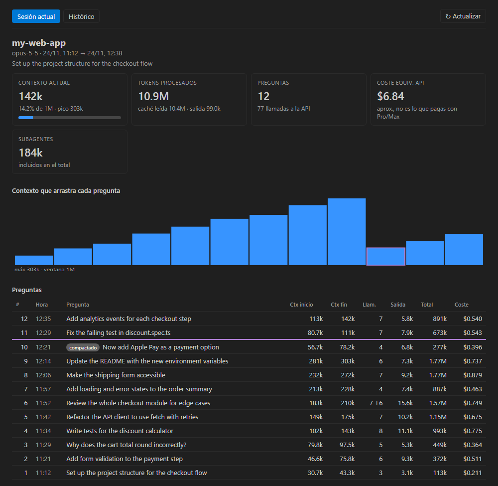
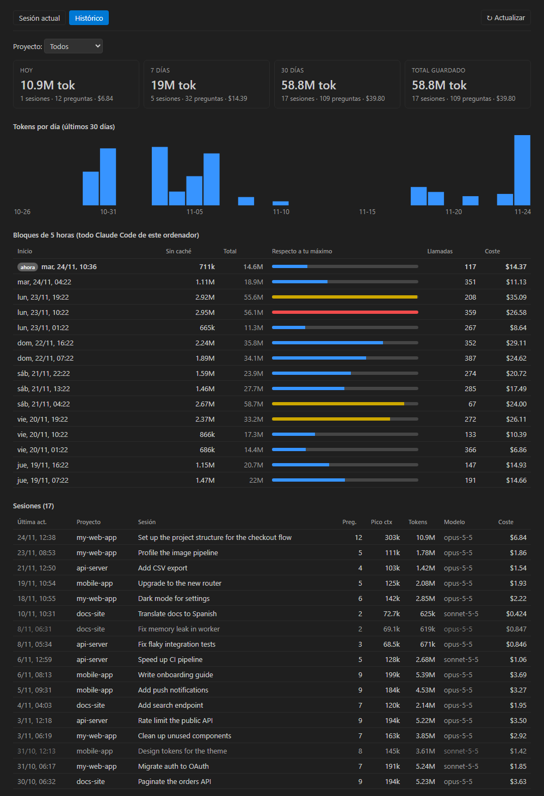

# Context Meter for Claude Code

> **Unofficial extension. Not affiliated with, endorsed by or sponsored by Anthropic.** "Claude" and "Claude Code" are trademarks of Anthropic, used here only to describe what the extension works with.

See how much you are using Claude Code without leaving VS Code: the context of the current conversation, what each chat costs, your 5-hour and weekly limits, and a history of all your sessions. Everything runs locally: no network, and nothing in Claude Code is changed.

*The extension's interface is currently in Spanish. [Versión en español más abajo](#español).*

## Features

### Claude Meter view (below the Claude Code chat)

Sits in the sidebar right below the Claude Code chat. Hover over any value and a tooltip explains what it means.

- **Context**: how many tokens the conversation carries out of the model's window (1M or 200K), with a grid of squares (1 % of the window each) showing where it comes from: cache, newly cached or uncached.
- **Last call**: cache read, cache write, new input and output.
- **Session**: prompts, API calls, tokens processed with and without cache reads, subagents and API-equivalent cost, plus a bar showing how much of it is cache reads.
- **Last prompt**: how much context it added and what it cost.
- **Official 5-hour and weekly limits**: the % used and the reset time that Claude Code stores when it checks your usage (for example with `/usage`), with the weekly split by product. It always shows how old that data is.
- **Current window**: what **this project** has used in the current 5-hour window, and the total for **all your projects** on this computer, broken down by project, with a green dot on the ones working right now.

### Status bar

Three short indicators: context, session and 5-hour limit. With `claudeMeter.statusBar` you can show all three, only the context, or none.

### Full panel

Opened from the view or the status bar.

- **Current session** (*Sesión actual*): context carried by each prompt and a prompt-by-prompt table. Compactions are highlighted.
- **History** (*Histórico*): today, 7 days, 30 days and all time; tokens per day; previous 5-hour blocks; and every session (click for details), filterable by project.

## Installation

1. Download the `.vsix` file from the latest [release](https://github.com/ManuelCebreiro/claude_context_meter/releases).
2. Install it:
   - In VS Code: Extensions view → `···` menu → **Install from VSIX…** and pick the file.
   - From a terminal: `code --install-extension context-meter-for-claude-code-<version>.vsix`
3. Open a folder where you use Claude Code and send Claude a message.

Requires VS Code 1.90 or later. The view is placed below the official Claude Code extension's chat; if that extension is not installed, it appears in the Explorer. If you can't find it, run **Claude Meter: Mostrar la vista** from the Command Palette (`Ctrl+Shift+P`).

## Settings

| Setting | Default | What it does |
|---|---|---|
| `claudeMeter.statusBar` | `all` | What to show in the status bar: `all`, `context` or `none`. |
| `claudeMeter.showCost` | `true` | Show the API-equivalent cost. |
| `claudeMeter.warningPercent` / `errorPercent` | `60` / `80` | Context % at which it turns yellow / red. |
| `claudeMeter.showBlock` | `true` | Show the 5-hour limit and the current window. |
| `claudeMeter.blockWarnRatio` | `0.8` | Fraction at which the limit turns yellow. |
| `claudeMeter.contextWindow` | `0` | Fixed context window in tokens (0 = automatic, based on the model). |
| `claudeMeter.saveToDisk` | `true` | Keep a history so it survives when Claude Code deletes old transcripts. When off, the extension writes nothing to disk. |
| `claudeMeter.priceOverrides` | `{}` | Your own prices per model (USD per million tokens). |
| `claudeMeter.pollMs` | `1500` | How often (ms) the active chat is re-read. |

## How it works and privacy

- It reads the transcripts Claude Code already saves in `~/.claude/projects/` and, for the official limits only, the usage Claude Code stores in `~/.claude.json`. From that file it only extracts the percentages and reset times, nothing about your account.
- It makes no network requests, installs no hooks and never writes to `~/.claude`.
- It keeps its own history (`history.json` and `blocks.json`) in the extension's storage, unless you turn off `claudeMeter.saveToDisk`.
- Files are read asynchronously and in chunks, so VS Code is never blocked.

## Notes

- **Tokens processed** includes cache reads: on every call, Claude Code resends the whole context, so in long chats they are most of the volume. That's why tokens **without cache reads** are shown too.
- The **official limit** only updates when Claude Code checks your usage; if the data is old, the view says so.
- Tokens in the **current window** only cover Claude Code on this computer, not claude.ai, Cowork or other devices (the official % does include them).
- The **cost** is an estimate based on public API prices; on a Pro or Max plan it is not what you pay.

## Development

- `npm test` runs the tests (Node, no dependencies).
- F5 opens a VS Code window with the extension loaded.
- `npx @vscode/vsce package --no-dependencies` builds the `.vsix`.

---

## Español

> **Extensión no oficial. No está afiliada, respaldada ni patrocinada por Anthropic.** "Claude" y "Claude Code" son marcas de Anthropic; aquí solo se usan para indicar con qué funciona la extensión.

Muestra tu consumo de Claude Code dentro de VS Code: el contexto de la conversación, lo que lleva cada chat, tus límites de 5 horas y semanal, y un histórico de tus sesiones. Funciona en local: no usa la red ni modifica nada de Claude Code.

- **Vista "Claude Meter"**, debajo del chat de Claude Code: contexto (con cuadraditos), última llamada, sesión, última pregunta, límites oficiales de 5 h y semanal, y la ventana actual de este proyecto y de todos tus proyectos. Al pasar el ratón por cada dato se explica qué es.
- **Barra de estado** con tres indicadores cortos (ajuste `claudeMeter.statusBar`).
- **Panel completo** con la sesión pregunta a pregunta y el histórico.

**Instalación:** descarga el `.vsix` de la última [release](https://github.com/ManuelCebreiro/claude_context_meter/releases) y, en VS Code, Extensiones → `···` → **Instalar desde VSIX…**

**Privacidad:** solo lee los transcripts de `~/.claude/projects/` y, para los límites oficiales, el % y las horas de reinicio que Claude Code guarda en `~/.claude.json`. No se conecta a nada ni escribe en `~/.claude`.

Licencia MIT.
